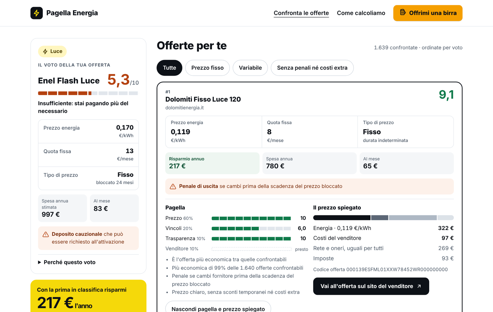
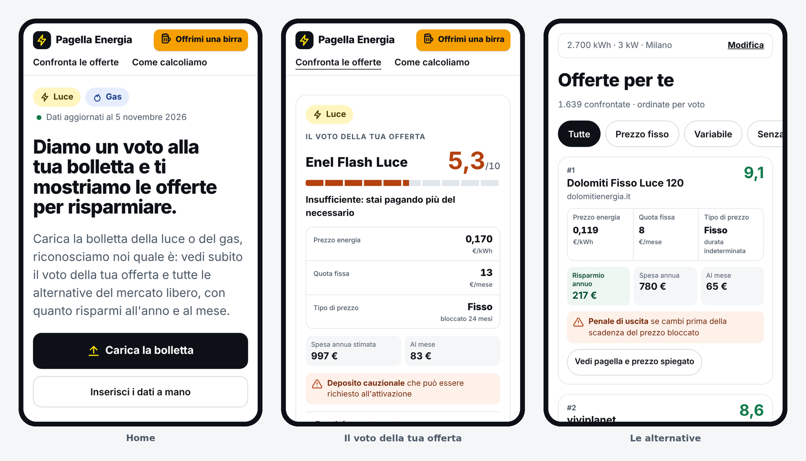
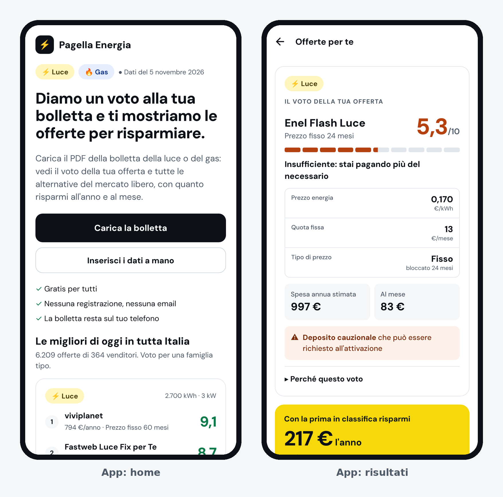
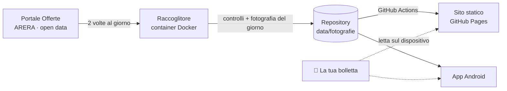

<div align="center">

# ⚡ Pagella Energia

**Diamo un voto alla tua bolletta della luce e del gas e ti mostriamo le offerte per risparmiare.**

Gratis, senza registrazione, senza pubblicità. La bolletta resta sul tuo dispositivo.

[**Apri il sito**](https://pagellaenergia.it/) ·
[**Scarica l'app Android (anteprima)**](https://github.com/contino23/pagella-energia/releases/download/app-anteprima/pagella-energia-anteprima.apk) ·
[**Come calcoliamo il voto**](docs/METODOLOGIA.md) ·
[**Scrivimi**](https://pagellaenergia.it/contatti/)

[](https://github.com/contino23/pagella-energia/actions/workflows/test.yml)
[](https://github.com/contino23/pagella-energia/actions/workflows/sito.yml)
[](https://github.com/contino23/pagella-energia/actions/workflows/app-android.yml)
[](LICENSE)
[](https://www.ilportaleofferte.it/)



</div>

## Cos'è

Pagella Energia confronta **tutte le offerte luce e gas del mercato libero** pubblicate ogni giorno sul [Portale Offerte](https://www.ilportaleofferte.it/) di ARERA. Lo fa con i tuoi consumi e il tuo comune.

Carichi il PDF della bolletta e in pochi secondi vedi:

- **il voto della tua offerta**, da 0 a 10, con il perché;
- **le alternative in classifica**, ognuna con risparmio all'anno, spesa annua e spesa al mese;
- **prezzo dell'energia, quota fissa e tipo di prezzo** a colpo d'occhio, con il prezzo scontato quando ci sono sconti;
- **un avviso colorato** quando ci sono penali di uscita, depositi, costi una tantum o sconti solo iniziali.

Il Portale Offerte fa già un ottimo lavoro sui dati. Pagella Energia aggiunge tre cose: il **voto**, la **lettura automatica della bolletta** e gli **avvisi** sulle clausole che legano nel tempo.

## In breve

| | |
|---|---|
| 🧾 **Legge la bolletta** | Riconosce codice offerta, consumi, potenza, comune e prezzi pagati, e prima di mostrarti i risultati ti fa vedere cosa ha letto. |
| 🔒 **Privacy per costruzione** | Il PDF viene letto nel browser o nell'app, sul tuo dispositivo: non viene mai caricato su un server. I tuoi dati restano nell'indirizzo della pagina, dopo il `#`, che non arriva al server. |
| 🎓 **Un voto che vuol dire qualcosa** | 60% prezzo, 20% vincoli, 10% trasparenza, 10% venditore. Il 6 corrisponde a circa +10% rispetto alla più economica: un voto alto lo prendono solo le offerte davvero vicine alla migliore. |
| 🕰️ **Funziona anche con offerte vecchie** | Se la tua offerta non è più in vendita, la ricostruiamo dai prezzi stampati in bolletta e le diamo comunque un voto. |
| 📍 **Offerte del tuo comune** | Oltre a quelle nazionali, anche le offerte locali disponibili dove abiti. |
| 🔄 **Aggiornato ogni giorno** | I dati del Portale si scaricano due volte al giorno e si pubblicano solo se tutti i controlli passano. |
| ⚖️ **Neutrale** | Nessuna commissione dai venditori, nessun link di affiliazione, nessuna pubblicità. Metodo pubblico e codice aperto. |

## Sul telefono

<div align="center">

<br><br>

</div>

L'**app Android** è nativa (React Native con Expo) e usa la stessa logica di calcolo del sito, quindi i risultati coincidono. È in anteprima: l'[APK](https://github.com/contino23/pagella-energia/releases/tag/app-anteprima) si installa a mano. La pubblicazione sul Play Store arriverà dopo i test.

## Come funziona



1. **Raccolta.** Un piccolo container ([`raccoglitore/`](raccoglitore)) scarica i file open data del Portale (offerte, parametri regolati, storico di PUN e PSV), li normalizza in una "fotografia" del giorno e la pubblica qui, solo se i test passano.
2. **Stima della spesa.** Per ogni offerta calcoliamo la spesa annua con lo stesso algoritmo del Portale: le *Regole per il calcolo della Spesa* v3.02 di Acquirente Unico. Per le offerte variabili usiamo la media degli ultimi 3 mesi dell'indice.
3. **Voto e classifica.** Ogni offerta riceve un voto da 0 a 10 su prezzo, vincoli, trasparenza e venditore. Tutti i dettagli sono in [docs/METODOLOGIA.md](docs/METODOLOGIA.md), anche sul sito nella pagina *Come calcoliamo*.
4. **Sito e app.** Sono pagine statiche e un'app che fanno i conti sul dispositivo. Non c'è un server applicativo da attaccare e non c'è un database di utenti.

## Struttura del repository

```
packages/core     logica condivisa: modello delle offerte, stima della spesa luce e gas,
                  voto, classifica, lettura della bolletta, offerta ricostruita
pipeline/         lettura dei file open data, fotografie giornaliere, export per sito e app, test
apps/web          sito (Astro): home, risultati, metodo, lettore PDF (pdf.js)
apps/mobile       app Android (Expo / React Native)
raccoglitore/     container Docker che aggiorna i dati ogni giorno
design/           design system: colori, tipografia, componenti
data/fotografie   una cartella per giorno: offerte normalizzate, manifest con impronte SHA-256, report qualità
docs/             metodologia pubblica, guida all'aggiornamento dei dati, cose da fare
```

## Sviluppo in locale

Serve Node.js 22.

```bash
git clone https://github.com/contino23/pagella-energia.git
cd pagella-energia
npm install

npm test                  # test di lettore, calcoli, voto, bolletta, download
npm run dati-web          # prepara offerte.json e mercato.json per sito e app
npm run sito              # build del sito in apps/web/dist

cd apps/web && npx astro dev        # sito in locale
cd apps/mobile && npx expo start    # app (Expo Go o emulatore Android)
```

Per creare una fotografia da file scaricati a mano:

```bash
npm run leggi -- ../data/raw/2026-11-03 ../data/fotografie
```

L'aggiornamento automatico dei dati è descritto in [docs/AGGIORNAMENTO-DATI.md](docs/AGGIORNAMENTO-DATI.md).

## Fonti dei dati

- **Offerte, parametri regolati e indici:** [Portale Offerte](https://www.ilportaleofferte.it/) di ARERA e Acquirente Unico, open data. Riuso libero citando la fonte.
- **Comuni, CAP e regioni:** dati ISTAT, tramite il progetto open source [comuni-json](https://github.com/matteocontrini/comuni-json).
- **Accise e addizionali regionali del gas:** tabelle ufficiali vigenti, aggiornate a mano.

Pagella Energia non è affiliato ad ARERA, ad Acquirente Unico né ad alcun venditore. Le stime sono indicative: le condizioni vincolanti sono quelle del contratto del venditore.

## Contribuire

Segnalazioni e proposte sono benvenute nelle [issue](https://github.com/contino23/pagella-energia/issues), in particolare:

- **una bolletta che non viene letta bene.** Indica il venditore e cosa non torna, **senza allegare la bolletta** né dati personali;
- **un'offerta con spesa o avvisi che non tornano**, con il codice offerta;
- **idee sul metodo di voto.** Ogni cambiamento viene registrato nella [metodologia](docs/METODOLOGIA.md) con la data.

## Contatti

Per problemi, segnalazioni, giudizi o magari, perché no, anche ringraziamenti: [**scrivimi**](https://pagellaenergia.it/contatti/). Leggo tutto e rispondo appena posso.

## Prossimi passi

- App Android sul Play Store, con il lettore PDF incluso nell'app per funzionare anche offline
- Voto sull'affidabilità del venditore, dallo storico delle offerte
- Lettura delle bollette da foto, oltre al PDF
- App iOS

## Sostieni il progetto

Pagella Energia è gratuito e senza pubblicità. Se ti ha fatto risparmiare, [offrimi una birra 🍺](https://www.paypal.me/lucacolosimo23/4EUR).

## Licenza

Il codice è rilasciato con licenza [GNU AGPL v3 o successiva](LICENSE): puoi usarlo, modificarlo e ridistribuirlo, anche come servizio online, a patto di pubblicare le modifiche con la stessa licenza.

---

<div align="center">
Creato per passione da <a href="https://www.slashservices.it">Slash Services</a> · <a href="https://pagellaenergia.it/contatti/">Scrivimi</a>
</div>
